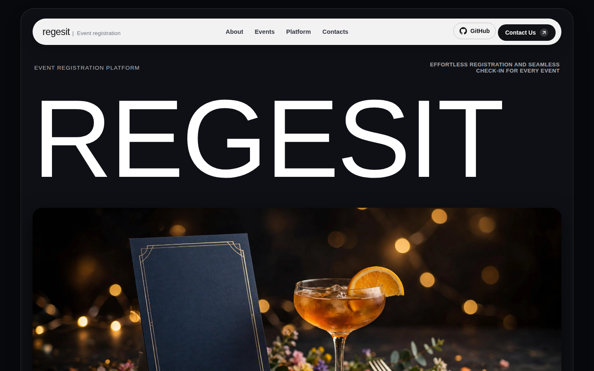
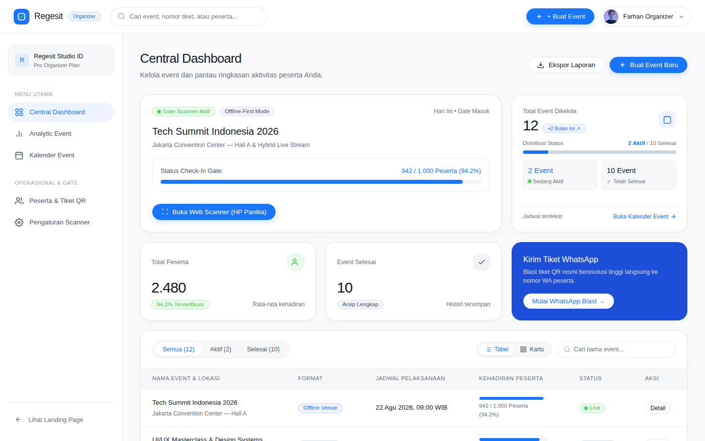
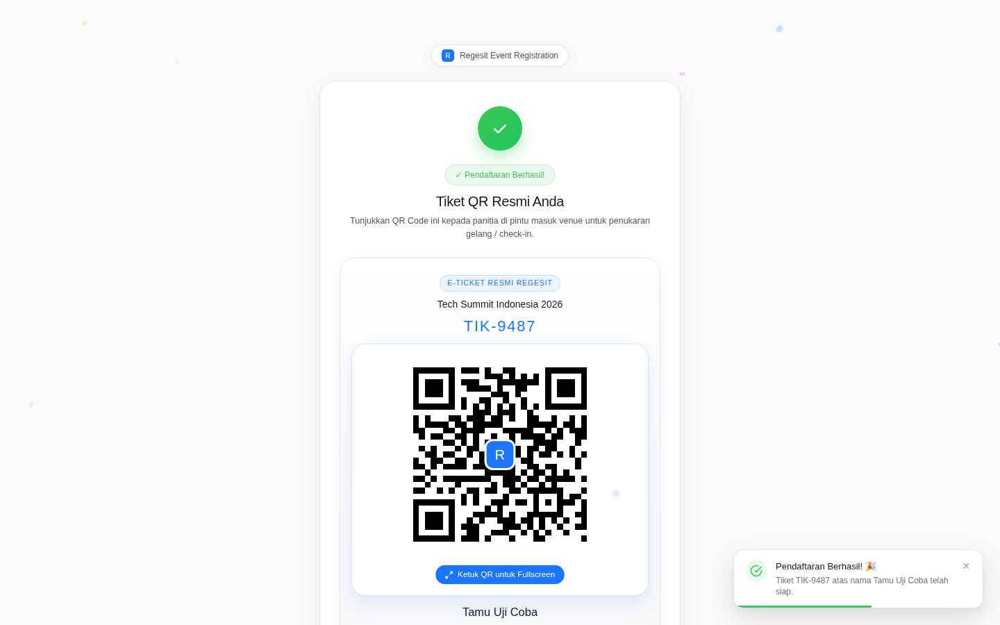
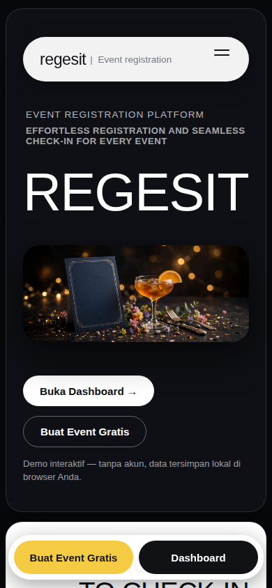

# Regesit — UI Rework

**Platform registrasi event & QR check-in — versi UI statis multi-halaman.**
Buat event, daftarkan peserta, terbitkan tiket QR, dan scan di pintu masuk —
semuanya jalan di browser, tanpa backend.

🔗 **Live demo:** https://regesit-ui-rework.pages.dev
📹 **Video demo (60 detik, 12 adegan):** [docs/demo/demo.mp4](docs/demo/demo.mp4)
📖 **Dokumentasi lengkap:** [docs/](docs/)



## Yang bisa dicoba langsung

| Halaman | Alamat | Isinya |
|---|---|---|
| Landing | [`index.html`](index.html) | Hero, event unggulan, layanan, seksi demo, footer |
| Dashboard organizer | [`dashboard.html`](dashboard.html) | Daftar event, analitik, kalender, ekspor CSV peserta |
| Buat event (wizard) | [`create-event.html`](create-event.html) | 4 langkah: info dasar → waktu & lokasi → kuota & tiket → formulir peserta |
| Pendaftaran peserta | [`register.html`](register.html) | Form + tanda tangan digital → tiket QR |
| Gate scanner | [`scanner.html`](scanner.html) | Viewfinder scan, verifikasi tiket, feed check-in real-time |

Alurnya saling terhubung: event yang dibuat lewat wizard **muncul di dashboard**
(tersimpan di `localStorage`), dan tiket QR yang terbit di pendaftaran bisa
dipindai di scanner.





## Desain & referensi

Kontrak arah desain: [docs/DESIGN.md](docs/DESIGN.md) (palet bernama,
tipografi, layout, detail khas "tiket berlubang").

- **Referensi pemenang:** Onstage — Framer event template
  (https://www.framer.com/marketplace/templates/onstage/) — cover ala poster,
  tiket sebagai artefak, sticky ticket bar di ponsel. Diambil strukturnya
  (hero poster + kartu tiket + sticky CTA), bukan clone penuh — landing ini
  desain asli produk Regesit yang dipertahankan.
- **Gate 7 sumbu** (nilai 1–5, tiap sumbu ≥ 4): anti-slop 5, UX speed 4,
  tipografi 5, spacing & geometri 4, motion 4, a11y 4, mobile 4.
  Nol larangan P0 (tanpa gradient ungu/biru, tanpa Inter, tanpa emoji
  fungsional, tanpa hiasan 01/02/03) — ditegakkan `scripts/check-links.mjs`.
- **Tes siluet:** [docs/screenshots/13-silhouette.png](docs/screenshots/13-silhouette.png)
  — thumbnail hitam-putih landing masih terbaca sebagai platform event.

## Menjalankan lokal

Tidak ada proses build. Situs ini murni HTML/CSS/JS statis — sajikan saja
folder repo lewat server statis apa pun:

```bash
# Cara 1 — server bawaan repo (disarankan, resolusi path ala Pages)
npm run dev          # http://127.0.0.1:8329

# Cara 2 — Python
python3 -m http.server 8329

# Cara 3 — npx
npx serve .
```

`npm install` hanya diperlukan untuk perkakas pengembangan (validasi HTML,
tes Playwright, deploy): situsnya sendiri **tanpa dependensi runtime**.

## Fitur

- **Landing ala SaaS** — navbar + tautan GitHub, hero + CTA ke produk, seksi
  "Coba Produk" yang menaut ke keempat halaman aplikasi, footer.
- **Wizard buat event 4 langkah** — validasi per langkah, pilih format
  (Offline/Online/Hybrid), tambah pertanyaan kustom, simpan ke dashboard.
- **Dashboard organizer** — modul Central/Analytics/Kalender, tabel + kartu
  event (bisa dicari & diganti tampilan), modal detail 4 tab (link & QR,
  edit, peserta, scanner), ekspor data peserta ke **CSV beneran**.
- **Pendaftaran peserta** — validasi real-time + toast, kanvas tanda tangan
  digital, confetti, tiket QR + lightbox fullscreen, unduh QR sebagai file.
- **Gate scanner** — kamera (bila tersedia) atau viewfinder simulasi,
  bunyi sukses, kartu verifikasi + stempel, feed check-in, check-in manual
  (kode/nama), mode standby & auto-scan.
- **QR dibuat lokal di browser** — `js/vendor/qrcode.min.js`
  (qrcode-generator 1.4.4, MIT). Tidak ada lagi ketergantungan ke
  `api.qrserver.com`: tiket tetap terbit saat offline.

## Data demo & penyimpanan

Semua data bersifat **demo dan lokal**:

- 4 event contoh + 4 peserta contoh sudah tertulis di HTML dashboard.
- Event buatan pengguna disimpan di `localStorage` kunci `regesit.events.v1`
  (lihat [docs/data.md](docs/data.md)). Hapus lewat DevTools →
  Application → Local Storage bila ingin kembali ke data awal.
- Tidak ada akun, tidak ada server, tidak ada data yang keluar dari browser
  — kecuali font Google dan satu avatar contoh (Unsplash) yang dimuat dari CDN.

## Struktur proyek

```
index.html  dashboard.html  create-event.html  register.html  scanner.html
css/            style.css  dashboard.css  create-event.css  register.css  scanner.css
js/             main.js  dashboard.js  create-event.js  register.js  scanner.js
                store.js (localStorage)  qr.js (helper QR lokal)
                vendor/qrcode.min.js (qrcode-generator 1.4.4, MIT)
Assets/         mavka/*.jpg (gambar landing)  tech_summit_banner.jpg
                scanner_camera_feed.jpg
Documentation/  situs docs hand-off FE→BE asli penulis (arsip, lihat docs/)
docs/           PRD, arsitektur, halaman, data, desain, testing, deploy,
                diagram (diagrams.html), screenshots/, demo/demo.mp4
scripts/        serve.mjs  check-links.mjs  screenshot.mjs  make-video.mjs
                advisory-sweep.py (OSV, tanpa auth)
e2e/            smoke.spec.js (Playwright, 5 tes alur penuh)
```

## Testing

```bash
npm run validate   # check-links (referensi, anchor, sapu secret, QR lokal)
                   # + html-validate 5 halaman
npm test           # Playwright e2e (butuh Chromium; di CI di-install otomatis)
npm run screenshots  # hasilkan ulang docs/screenshots/*.png
npm run make-video   # rangkai screenshot jadi docs/demo/demo.mp4
npm run sweep      # OSV advisory sweep (0 dependensi produksi)
```

CI (`.github/workflows/ci.yml`, 3 job): `static-checks`, `advisory-sweep`,
`playwright-e2e`. Detail + pengecualian yang didokumentasikan:
[docs/testing.md](docs/testing.md).

## Deploy

Cloudflare Pages, proyek `regesit-ui-rework` (lihat [docs/deploy.md](docs/deploy.md)):

```bash
npm run deploy   # wrangler pages deploy . --project-name=regesit-ui-rework
```

## Catatan jujur (rework 2026-11-19)

Repo ini sebelumnya menyimpan **gambar yang tidak pernah ter-commit**:
`.gitignore` lama meng-ignore seluruh folder `Assets/`, sehingga semua
`` di landing 404. Gambar di `Assets/` sekarang adalah hasil generate
baru (pengganti aset asli yang hilang) dan sudah ter-commit; `.gitignore`
diperbaiki agar `Assets/` tidak lagi di-ignore (hanya `*.psd`).

`CHANGELOG.md` lama mengklaim Next.js + Supabase — itu tidak benar untuk
repo statis ini dan sudah dikoreksi. `README.md` lama mengklaim
`npm install` + `npm run dev` padahal tidak ada `package.json` — kini
`package.json` ada (khusus dev tooling) dan cara jalan di atas sudah
terverifikasi.

## Lisensi

MIT — lihat [LICENSE](LICENSE). Dikembangkan oleh
[**dezzorigin**](https://github.com/dezzorigin) (Nabil Aulia Dika).
Produk live Regesit: [regesit.com](https://www.regesit.com).
