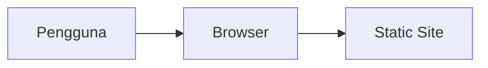

# Regesit Ui Rework

Regesit Ui Rework — project oleh Nabil Aulia Dika (dezzorigin).

## Status Proyek

**Hampir selesai (beta)** _(README ada, build artifact ada)_

## 📋 Tech Stack

HTML/CSS/JavaScript

## 🏗️ Arsitektur



## 📁 Struktur Proyek

```
Assets/
Documentation/
css/
js/
README.md
create-event.html
dashboard.html
index.html
register.html
scanner.html
shot_full.png
```

## 🚀 Getting Started

```bash
# Install dependencies
npm install

# Jalankan development server
npm run dev
```

> Untuk project HTML/Python/Go, lihat instruksi di atas atau file konfigurasi.

## 📄 Lisensi

MIT — lihat [LICENSE](./LICENSE).

---
_Dikembangkan oleh **dezzorigin** (Nabil Aulia Dika)._
